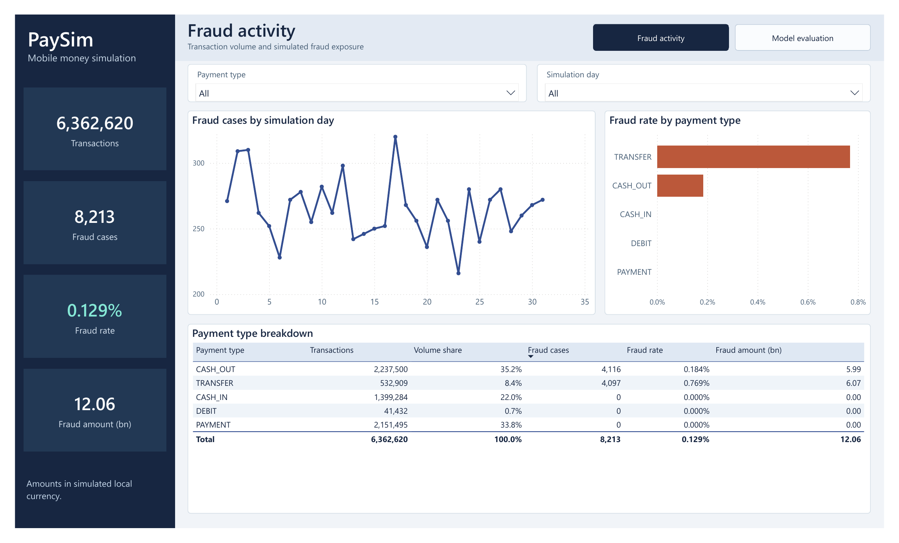
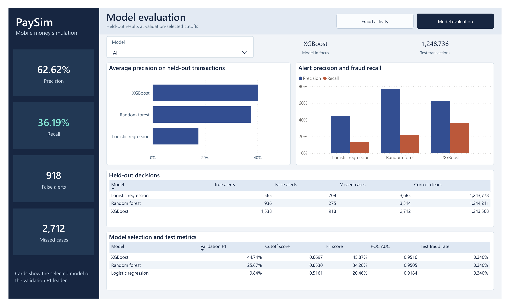

# PaySim mobile money fraud analytics

Two payment types account for all **8,213 fraud-labelled transactions** in this simulation. Cash-outs have slightly more cases, while a transfer is about **4.2 times** as likely to carry a fraud label. This project uses PostgreSQL, Python and Power BI to explore that difference and measure how three classifiers perform on later transactions.

[Download the Power BI report (.pbix)](https://github.com/aymaneben595/Credit-Card-Fraud-Analytics/raw/refs/heads/main/Power%20Bi/PaySim%20Fraud%20Review.pbix) · [Browse the editable report and semantic model](Power%20Bi) · [Original PaySim dataset](https://www.kaggle.com/datasets/ealaxi/paysim1)

## Fraud activity



| Payment type | Transactions | Fraud-labelled transactions | Fraud rate |
| --- | ---: | ---: | ---: |
| Cash-out | 2,237,500 | 4,116 | 0.184% |
| Transfer | 532,909 | 4,097 | 0.769% |
| Cash-in, debit and payment combined | 3,592,211 | 0 | 0.000% |
| **All transactions** | **6,362,620** | **8,213** | **0.129%** |

Use the **Payment type** and **Simulation day** filters to compare counts with rates. The labelled transactions sum to **12,056,415,427.84 in simulated local currency**. That figure measures the gross amount on transaction records. PaySim can record a transfer and a subsequent cash-out, and the file has no realized-loss or recovery field.

## Model evaluation



The holdout contains **1,248,736 transactions**, including **4,250 fraud labels**. XGBoost had the highest validation F1. On the holdout it raised **2,456 alerts**, of which **1,538** were true positives and **918** were false positives. It missed **2,712** labelled transactions. The random forest raised fewer false alerts (**275**) and caught fewer cases (**936**).

| Model | Test precision | Test recall | Test F1 | Test average precision |
| --- | ---: | ---: | ---: | ---: |
| XGBoost | 62.62% | 36.19% | 45.87% | 40.27% |
| Random forest | 77.29% | 22.02% | 34.28% | 37.58% |
| Logistic regression | 44.38% | 13.29% | 20.46% | 17.44% |

Select a model on the second page to inspect its decisions. With all models visible, the cards show the validation F1 leader. These results describe the PaySim simulation. They have not been validated on a live payment network.

### How the evaluation works

- **Split by complete simulation hours.** Training covers steps 1–281, validation covers 282–355, and testing covers 356–743. The split targets 60%, 20% and 20% of transaction volume while keeping each hour together.
- **Use information available at decision time.** Features are payment type, log amount and the hour within the 24-hour simulation cycle. The model excludes account IDs, the simulator’s existing flag, and all sender and receiver balance fields. The dataset author documents that the balances reflect how detected fraud is cancelled. [PaySim data description](https://www.kaggle.com/datasets/ealaxi/paysim1)
- **Choose cutoffs before testing.** Training uses all 3,193 training fraud cases and a reproducible sample of 200,000 legitimate transactions. Validation and test retain every transaction. Each model’s alert cutoff maximizes F1 on validation. A score is used to rank transactions and has not been calibrated as a probability of fraud.

## Corrections to the earlier project

| Earlier behavior | Correction |
| --- | --- |
| Python used `step % 7` to build a daily trend, while SQL treated each hour as a day. | Both now use `1 + (step - 1) // 24` with integer division. The full file spans 31 simulation days. |
| The README described credit-card activity and dollar losses. | The source simulates mobile money, and monetary values are expressed in its local currency. The report labels the amount represented by fraud records. |
| The model used balance changes and a random split. Its headline metrics also disagreed with its exported confusion matrix. | The revised benchmark excludes balance features, keeps future hours out of training, and calculates precision and recall directly from each model’s held-out decisions. |
| The import required a machine-specific path. The merchant indicator treated both customer and merchant prefixes as merchants. | The loader accepts a CSV or ZIP, validates the import, and identifies merchant destinations using the source’s `M` prefix. |

## Reproduce the results

Open the PBIX in Power BI Desktop to explore the included aggregates. To edit the report layout or DAX, clone the repository and open `Power Bi/PaySim Fraud Review.pbip` with its adjacent Report and SemanticModel folders.

1. Download the original dataset ZIP from the source above. Install the dependencies from the repository root.

   ```powershell
   python -m pip install -r requirements.txt
   ```

2. Rebuild the public summaries and model evaluation. Substitute the path to your downloaded ZIP or CSV.

   ```powershell
   python "VSCode, SQL & Python/Python/fraud_pipeline.py" --input "C:\data\paysim.zip"
   ```

3. To load PostgreSQL as well, copy `.env.example` to `.env`, set your database connection values, and run the same command with `--postgres`. This replaces the project’s `fraud.raw_transactions` snapshot and reconciles the SQL day-by-type totals with the independent CSV aggregation. An existing populated `fraud.transactions_clean` can be used by running the script without `--input`.

4. To update Power BI, set **Transform data → Edit parameters → ExportsFolder** to the absolute path of the pipeline’s `exports` directory, then refresh. A blank parameter uses the included verified snapshot.

The public report contains day-by-type totals and model-level decisions. Its embedded data has no transaction-level scores or account identifiers. The full source was checked using PostgreSQL 18. A test with an invalid fraud label preserved the previous successful database and export. The published run used pandas 2.3.3, scikit-learn 1.7.2 and XGBoost 3.4.1.

[Python pipeline](VSCode%2C%20SQL%20%26%20Python/Python/fraud_pipeline.py) · [PostgreSQL transformations](VSCode%2C%20SQL%20%26%20Python/SQL/fraud_pipeline.sql) · [Aggregate exports](VSCode%2C%20SQL%20%26%20Python/Python/exports)

PaySim was created by Edgar A. López-Rojas and collaborators. The published activity summaries are derived from the original synthetic financial dataset. [Dataset and license](https://www.kaggle.com/datasets/ealaxi/paysim1)

Aïmane Benkhadda
